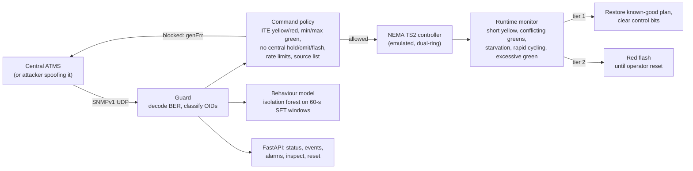
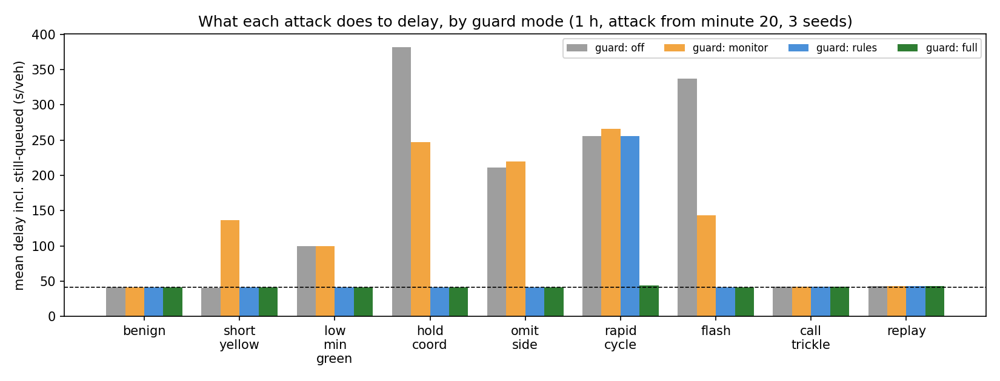

# ntcip-signal-tamper-guard

**An edge guard between central traffic management software and a field signal controller.** It sits
in the cabinet, decodes every NTCIP 1202 (SNMPv1) request, and checks each SET against the intersection's
geometry and the agency's timing standards before it reaches the controller. Behind it, a runtime monitor
watches what the controller actually displays, like a software conflict monitor, and falls back to the
last known-good plan or to red flash. A learned profile of normal command traffic catches patterns that
pass every per-command rule. The controller is an emulated NEMA TS2 dual-ring, actuated-coordinated unit
(from [synchro-vissim-ntcip-controller](https://github.com/faysalchowdhoury/synchro-vissim-ntcip-controller)).

**Headline (155 one-hour simulations, attacker spoofs the central system and knows the SNMP write community):**

* **Every direct tampering attack is stopped before it reaches the controller:** short yellows,
  low minimum greens, holds, omits, flash and rapid cycling. Delay stays at the benign 41 s/veh,
  against up to **381 s/veh** with no guard.
* **Defence in depth matters.** Command rules alone did not stop rapid cycling (delay 256 s/veh): the first
  force-off got through before the rate limit and persisted. The runtime monitor cleared it and brought
  delay back to 44 s/veh.
* **No false alarms in 20 benign hours** (status polls every second, plan changes, operator tweaks, transit calls).
* **Not caught by anything:** replaying a valid, captured timing command at the wrong time. That needs
  authenticated, time-stamped messages (SNMPv3), not a better filter.

---

## 1. Problem formulation

Traffic signal controllers are managed over NTCIP 1202, which in most deployments runs on SNMPv1: the
"password" (community string) crosses the network in clear text. Anyone who reaches the field network can
change timing or drive the control objects that central systems use (holds, force-offs, omits, calls,
pattern changes). The controller's own range checks accept many dangerous values. A 3.0-s yellow is legal
to the controller, but on a 45-mph approach the ITE change interval is 4.3 s. Unsafe intervals, starved
movements and gridlock are all reachable without touching the conflict monitor.

| Bar | Here |
|---|---|
| **Traffic engineering** | NEMA dual-ring barrier logic, coordination with fixed force-offs, ITE change and clearance intervals, minimum and maximum green standards, delay and starvation impacts, fail-safe flash as all-way stop |
| **Security** | Threat model with a spoofing insider, protocol-aware filtering of SNMPv1 SETs, runtime invariant monitoring, two-tier fail-safe, learned command profile, honest list of what is not caught |
| **Systems** | Hand-written BER codec, asyncio UDP proxy, FastAPI operator API, 155 parallel simulations, Docker |

---

## 2. Architecture



---

## 3. Methodology

**Intersection.** Eight phases, 100-s cycle, coordinated phases 2 and 6 (45-mph arterial), 35-mph side street,
protected lefts. Volumes give v/c of about 0.6-0.7 on every movement. A point-queue model (Poisson arrivals,
saturation flow after 2 s of start-up lost time) measures delay, including vehicles still queued at the end
of the hour, since an attack that stops service would otherwise look like *lower* delay. Red flash is modelled
as an all-way stop (one vehicle every 2.5 s).

**Command policy** (each SET, varbind by varbind; `high` or `critical` blocks the whole SET with `genErr`):

| Rule | Basis |
|---|---|
| yellow ≥ ITE change interval $Y = t + v/(2a + 2Gg)$ | t = 1 s, a = 3.05 m/s² (4.3 s at 45 mph) |
| red clearance ≥ $(W + L)/v$ | crossing width plus vehicle length |
| min green ≥ agency floor; max green within cap; change ≤ 50% | agency timing standards |
| no central hold, omit or flash; no omit of coordinated or called phases | operating policy (configurable) |
| ≤ 4 force-offs and holds per 5 min; ≤ 12 SETs per minute | rapid cycling and flooding |
| SET source on the allow list | weak on its own: UDP sources can be spoofed |

**Runtime monitor.** Short yellow served or conflicting greens: critical, straight to flash. Starvation (a
waiting phase unserved for 240 s), excessive green (150 s while others wait), or two cycles shorter than 60%
of the cycle within 5 minutes: tier 1, restore the known-good plan and clear control bits. If alarms recur
within 5 minutes: tier 2, flash. An operator reset is assumed 15 minutes after a flash. Only SETs that passed
the policy update the known-good plan, so an attacker cannot poison the restore point.

**Behaviour model.** Write traffic is summarised in 60-s windows (SET counts by object type, distinct objects
written) and an isolation forest is fitted on 30 benign hours. Reads are excluded. An early version counted
them and flagged harmless coincidences (a routine timing walk in the same minute as a valid SET).

**Experiment.** 9 scenarios (benign + 8 attacks starting at minute 20) × 4 guard modes (off, monitor only,
rules only, full) × 3 seeds, plus 17 extra benign hours for false alarms and 30 for training: 155 one-hour
runs at 10 Hz.

---

## 4. Results ([`results/attacks/RESULTS.md`](results/attacks/RESULTS.md))



**Mean delay (s/veh, incl. vehicles still queued), mean of 3 seeds; benign = 41.**

| Attack (from minute 20) | No guard | Monitor only | Rules only | Full guard | Detected after |
|---|---|---|---|---|---|
| short_yellow (3.0 s on 45 mph) | 41, **48 unsafe yellows** | 136 (2 unsafe, 15 min flash) | 41 | 41 | 0 s |
| low_min_green (2 s side street) | 99 | 99 (not detected) | 41 | 41 | 0 s |
| hold_coord (arterial held green) | **381** | 247 (28 min flash) | 41 | 41 | 0 s |
| omit_side (side street omitted) | 211 | 220 (24 min flash) | 41 | 41 | 0 s |
| rapid_cycle (force-off + call all, every 3 s) | 256 | 266 (33 min flash) | **256** | **44** | 12 s |
| flash (pattern 255) | 337 (40 min flash) | 143 | 41 | 41 | 0 s |
| call_trickle (phantom left calls every 30 s) | 42 | 42 | 42 | 42 | behaviour model, 620 s |
| replay (valid captured SET, wrong time) | 43 | 43 | 43 | 43 | **never** |

**False alarms in 20 benign hours (full guard):** 0 blocked SETs, 0 alerts, 0 monitor alarms, 0 behaviour-model
windows. Guard latency per SET (in-process): 257 µs median when allowed, 83 µs when blocked.

**Engineering reading.**

* **The short-yellow attack is invisible to traffic and dangerous to people.** Delay did not change (41 s/veh),
  but 48 yellows in 40 minutes were a second or more below what the approach speed needs, which puts drivers in
  the dilemma zone. Without command checks the monitor needs a short yellow to happen before it can see one;
  it caught it after 2.
* **Flash is safe and expensive.** Every monitor-only response ends in flash, costing 15-33 minutes of all-way
  stop operation and 2-6 times the benign delay. Blocking at the command level avoids that cost entirely,
  which is why the rules come first and flash is the last resort.
* **Rules and monitor fail differently.** Rules alone missed rapid cycling, because the damage persisted from
  commands sent before the rate limit tripped. The monitor alone missed the low minimum green, which degrades
  service without breaking an invariant. Only the combination handled all seven direct attacks.
* **What a filter cannot do.** Phantom calls that are individually legal were caught only by the behaviour
  model, and only after about 10 minutes. A replayed valid command was caught by nothing; it is
  indistinguishable from the real one. SNMPv3 (authentication with timeliness checks) and a cabinet network
  the guard alone can reach are the controls for that, and this guard does not replace them.
* **The behaviour model is weak on its own:** it caught rapid cycling and call trickle, and the blocked
  hold/omit attempts in 2 of 3 runs, late. It is an extra signal, not a primary control.

---

## 5. Layout, reproduce, limitations

```
src/ntcip_guard/controller.py   NEMA controller + NTCIP control bits (hold, force-off, omit, call) and flash
src/ntcip_guard/mib.py          NTCIP 1202 object subset and SNMPv1 agent
src/ntcip_guard/policy.py       ITE clearance formulas and the command policy
src/ntcip_guard/monitor.py      runtime invariants, two-tier fail-safe
src/ntcip_guard/guard.py        SNMP-aware filter ; behavior.py  learned command profile
src/ntcip_guard/traffic.py      point-queue traffic for delay ; scenarios.py  benign traffic, attacks, runner
src/ntcip_guard/proxy.py        live UDP deployment ; api/app.py ; study.py ; cli.py
src/ntcip_guard/vendor/         controller, timing models and BER codec (see VENDORED.md)
tests/ (9 tests: ITE formulas, policy decisions, control bits, guard blocking, monitor escalation,
        scenarios end to end, behaviour features, real UDP round trip, API)
```

```bash
python -m venv .venv && .venv/Scripts/activate
pip install -r requirements.txt && pip install --no-deps -e .
pytest
ntcip-guard study --seeds 3 --workers 2          # ~4 min -> results/attacks/
ntcip-guard serve --listen 127.0.0.1:1161         # guard on UDP 1161, operator API on :8000
docker build -f docker/Dockerfile -t ntcip-guard . && docker run -p 1161:1161/udp -p 8000:8000 ntcip-guard
```

**Limitations.** Emulated controller and one intersection; the NTCIP object subset follows the published
v03 MIB, but vendors add proprietary objects; pedestrian timing is not modelled; point-queue delay is a lower
bound and flash is a simple all-way stop; the attacker is assumed to go through the guard (in the field, the
controller's SNMP port must be reachable only from the guard); the behaviour model was trained on one
synthetic central-system profile.

## License

MIT
