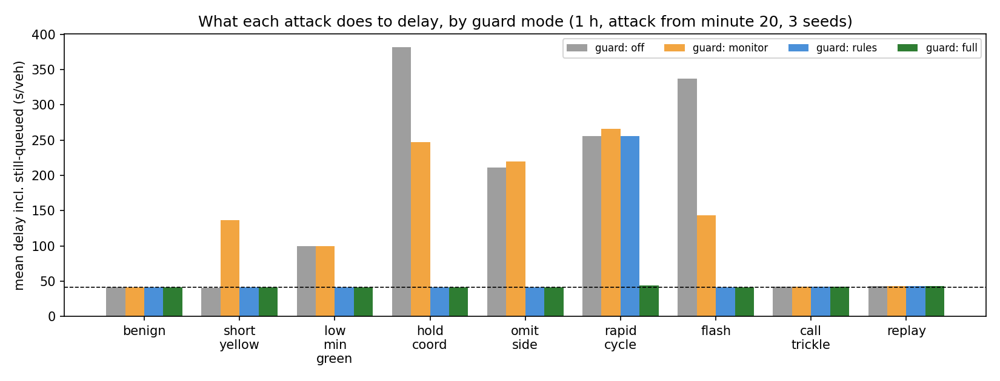

# NTCIP tamper guard results

155 one-hour runs. Attack starts at minute 20; the attacker spoofs the central system's address and knows the SNMPv1 write community.

## Delay (s/veh, incl. vehicles still queued) / unsafe short yellows / minutes in flash / detection (s)

| Scenario | off | monitor | rules | full |
|---|---|---|---|---|
| benign | 41 / 0 / 0 / - | 41 / 0 / 0 / - | 41 / 0 / 0 / - | 41 / 0 / 0 / - |
| short_yellow | 41 / 48 / 0 / - | 136 / 2 / 15 / 32 | 41 / 0 / 0 / 0 | 41 / 0 / 0 / 0 |
| low_min_green | 99 / 0 / 0 / - | 99 / 0 / 0 / - | 41 / 0 / 0 / 0 | 41 / 0 / 0 / 0 |
| hold_coord | 381 / 0 / 0 / - | 247 / 0 / 28 / 149 | 41 / 0 / 0 / 0 | 41 / 0 / 0 / 0 |
| omit_side | 211 / 0 / 0 / - | 220 / 0 / 24 / 217 | 41 / 0 / 0 / 0 | 41 / 0 / 0 / 0 |
| rapid_cycle | 256 / 0 / 0 / - | 266 / 0 / 33 / 70 | 256 / 0 / 0 / 12 | 44 / 0 / 0 / 12 |
| flash | 337 / 0 / 40 / - | 143 / 0 / 15 / 0 | 41 / 0 / 0 / 0 | 41 / 0 / 0 / 0 |
| call_trickle | 42 / 0 / 0 / - | 42 / 0 / 0 / - | 42 / 0 / 0 / - | 42 / 0 / 0 / - |
| replay | 43 / 0 / 0 / - | 43 / 0 / 0 / - | 43 / 0 / 0 / - | 43 / 0 / 0 / - |

## False alarms (20 benign hours, full guard)

* blocked SETs per hour: 0.00; alerts per hour: 0.00
* monitor alarms per hour: 0.00; fail-safe actions per hour: 0.00
* behaviour model: 0.00 flagged 60-s windows per hour

## Behaviour model (isolation forest on 60-s command windows)

| Attack | Detected (share of seeds) | Mean time to detect (s) |
|---|---|---|
| short_yellow | 0% | - |
| low_min_green | 0% | - |
| hold_coord | 67% | 1380 |
| omit_side | 67% | 1380 |
| rapid_cycle | 100% | 60 |
| flash | 0% | - |
| call_trickle | 100% | 620 |
| replay | 0% | - |

## Guard latency per SET (in-process)

allowed p50 257 us, p99 3005 us; blocked p50 83 us, p99 936 us

